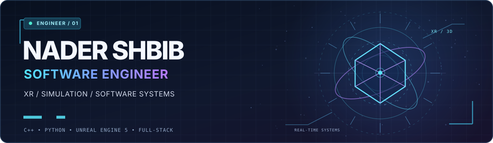
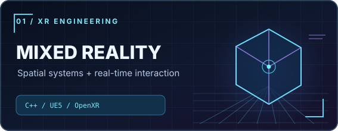
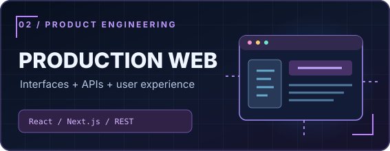
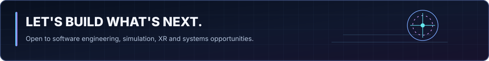

 

### Hey, I'm Nader. 👋

I'm a **software engineer** who enjoys building where **code, simulation, real-time graphics, and practical problem-solving** meet. My experience spans a **Qualcomm-associated mixed-reality capstone** and a **front-end engineering internship at Aimia.me**, from C++ and immersive systems to production web interfaces and API integrations.

I care about software that is **modular, testable, understandable, and useful**. I'm especially interested in simulation and XR engineering, software integration, debugging complex systems, and full-stack development.

---

## ⚡ Experience highlights

<table>
<tr>
<td width="50%" valign="top">
  
  <h3>Qualcomm-associated XR capstone</h3>
  
<strong>Mixed reality · C++ · Unreal Engine 5</strong>

  
Developed and integrated interactive mixed-reality functionality using <strong>C++, Unreal Engine 5, and OpenXR</strong>, targeting the <strong>Snapdragon XR2 Gen 2</strong> platform. Worked with spatial interactions, real-time rendering constraints, debugging, and feature validation.

  
<strong>Engineering perspective:</strong> real-time behavior, hardware-aware development, and bridging software components in an immersive environment.

</td>
<td width="50%" valign="top">
  
 <h3><a href="https://aimia.me/" target="_blank">Aimia.me</a> · Front-End Engineering Intern</h3>
  
<strong>Production software · React · Next.js</strong>

  
Built responsive application interfaces for an AI-powered career platform using <strong>React, Next.js, and Tailwind CSS</strong>. Integrated <strong>REST APIs</strong> into user-facing features and contributed to usability, cross-device behavior, and collaborative software delivery.

  
<strong>Engineering perspective:</strong> maintainable UI components, application integration, and shipping software for real users.

</td>
</tr>
</table>

## 🧰 Engineering toolkit

**Languages**

**Frameworks, engines & tools**

## 🧭 What I bring to an engineering team

| Engineering focus | How I approach it |
| :--- | :--- |
| **Simulation & real-time software** | Interest backed by hands-on XR development, spatial interactions, and real-time 3D workflows. |
| **Software integration** | Experience connecting application components, APIs, and interactive systems. |
| **Debugging & validation** | Comfortable investigating behavior, isolating defects, and iterating toward reliable results. |
| **Modular engineering** | Value clean interfaces, reusable components, clear documentation, and Git-based collaboration. |
| **Cross-disciplinary learning** | Drawn to the intersection of mathematics, physics, graphics, and software engineering. |

Currently expanding my knowledge of simulation frameworks, interoperability, automated testing, and distributed communication patterns. These are learning interests, not claims of professional experience with any particular defense framework.

## 🎓 Background

**B.S. Software Engineering** — California State University San Marcos · 2026

My foundation combines engineering coursework, immersive software development, production web engineering, and technical instruction. I'm motivated by difficult problems, thoughtful design, and software that works outside of a demo.

**[Connect on LinkedIn](https://www.linkedin.com/in/nadershbib/)** &nbsp; · &nbsp; **[Engineering portfolio](https://nadershbib.com/)** &nbsp; · &nbsp; **[Built by Nader](https://builtbynader.com/)** &nbsp; · &nbsp; **[CodePen](https://codepen.io/nadershbib)**

